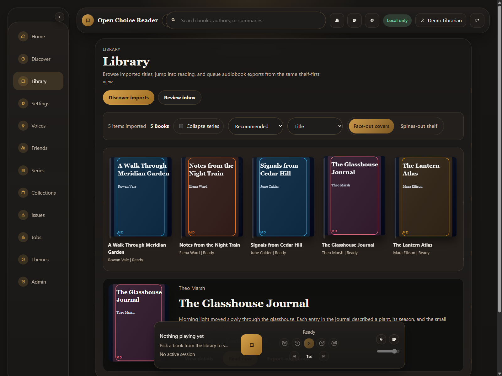
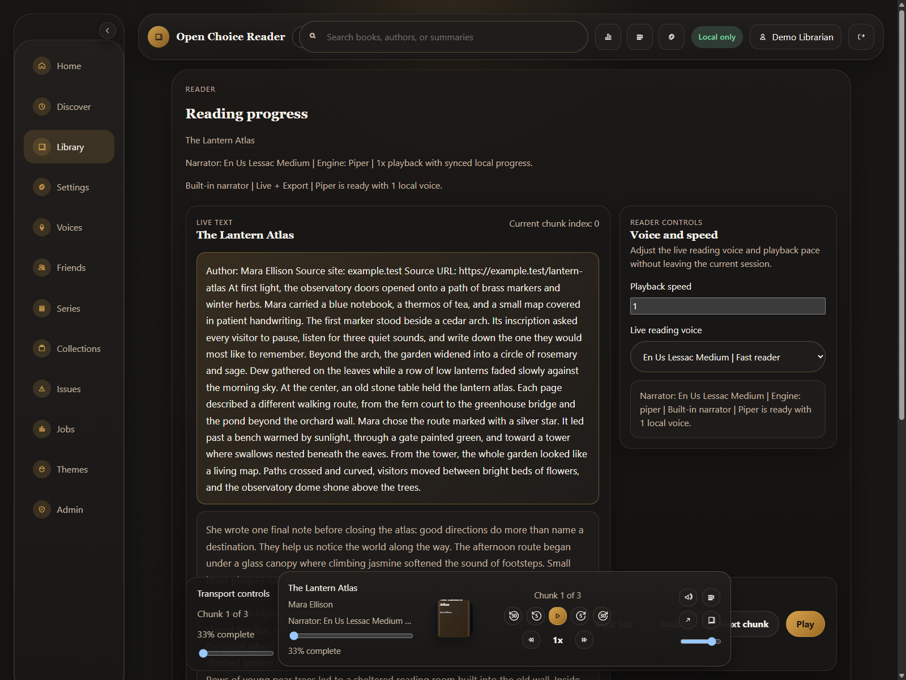
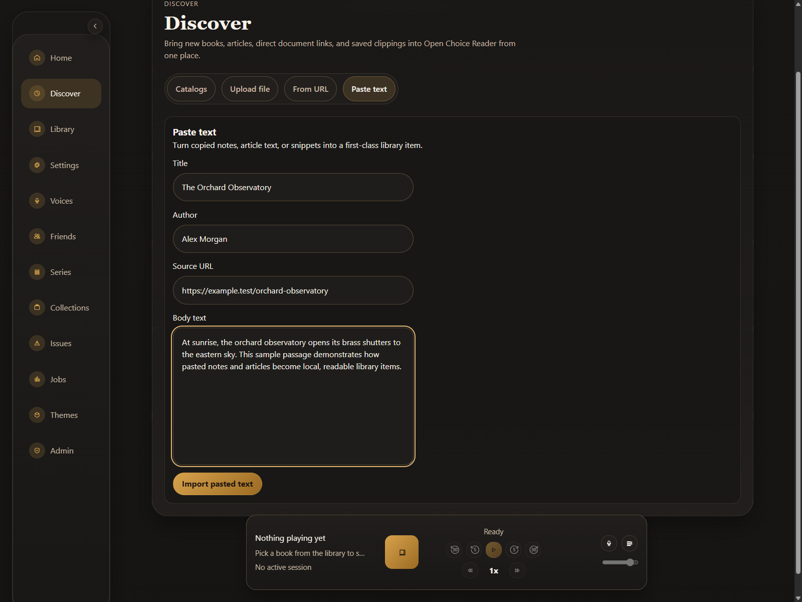
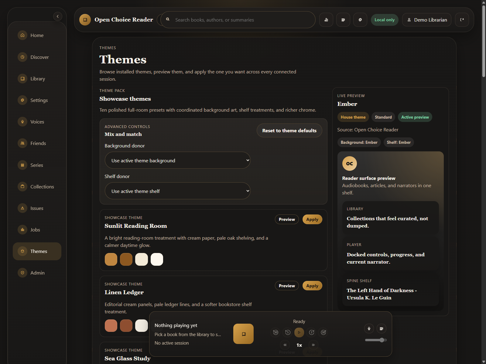
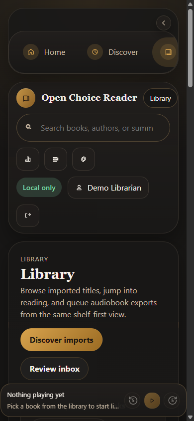

# Open Choice Reader

Open Choice Reader is a self-hosted reading library that turns documents, articles, and public-domain books into a private, local-first read-aloud experience.



## What it does

- Imports text, Markdown, HTML, EPUB, and text-based PDF files.
- Saves articles, pasted text, and supported public-domain catalog entries.
- Reads in the browser with synchronized progress and local speech generation.
- Exports WAV audiobooks, including chapter-split exports.
- Uses Piper by default, with optional Kokoro and Qwen voice-cloning runtimes.
- Keeps each signed-in user's documents, covers, voices, cache, and exports separate.
- Includes an optional Chromium extension for sending a page or selection to the reader.

Open Choice Reader is currently source-only, pre-release software. See [STATUS.md](STATUS.md) for the supported surface and known limitations.

## A closer look

| Reader | Import pasted text |
| --- | --- |
|  |  |

| Theme gallery | Responsive library |
| --- | --- |
|  |  |

All screenshots use synthetic books, names, and `example.test` URLs.

## Prerequisites

- Python 3.12, 3.13, or 3.14
- Node.js 22.12 or newer and npm
- FFmpeg, libsndfile, SoX, and eSpeak NG
- Linux or WSL for the bundled host scripts; Windows PowerShell is supported for development

GPU acceleration is optional. The base install uses Piper; optional engines have additional runtime and model requirements.

## Quick start on Ubuntu or WSL

```bash
git clone https://github.com/NotADevIAmaMeatPopsicle/Open-Choice-Reader.git
cd Open-Choice-Reader
bash scripts/bootstrap.sh
(cd frontend && npm run build)
bash scripts/start.sh
```

Open <http://127.0.0.1:8000>, create the first administrator, and stop the service with:

```bash
bash scripts/stop.sh
```

`bootstrap.sh` installs the required Ubuntu/Debian packages, creates `backend/.venv`, installs the application, installs frontend packages, and downloads the default Piper voice. Run `start.sh` as a normal unprivileged user.

## Development setup

```bash
cd backend
python -m venv .venv
source .venv/bin/activate
python -m pip install --upgrade pip
python -m pip install -e ".[dev]"
python -m alembic upgrade head

cd ../frontend
npm ci
```

On Windows PowerShell, activate the environment with `.\.venv\Scripts\Activate.ps1`, then launch the development servers from the repository root:

```powershell
.\scripts\dev.ps1
```

The development frontend runs at `http://127.0.0.1:5173` and proxies the API at `http://127.0.0.1:8000`.

## Build, test, and run

```bash
# Backend
cd backend
python -m ruff check app tests
python -m pytest -q
python -m alembic check

# Frontend
cd ../frontend
npm test
npm run build

# Chromium extension
cd ../browser-extension
node --test tests/core.test.mjs
```

After building the frontend, the FastAPI service serves the application and its API from one origin. API documentation is available at `/docs` and `/openapi.json` while the service is running.

## Configuration

Copy the example and edit only what your installation needs:

```bash
cp backend/.env.example backend/.env
```

Every backend environment variable begins with `OPEN_CHOICE_READER_`. Keep real secrets out of Git. For a remote HTTPS installation, typical values look like:

```dotenv
OPEN_CHOICE_READER_AUTH_BOOTSTRAP_TOKEN=<LONG_RANDOM_TOKEN>
OPEN_CHOICE_READER_AUTH_SESSION_SECURE=true
OPEN_CHOICE_READER_CORS_ALLOWED_ORIGINS=https://reader.example.test
```

The service binds to loopback by default. Read [docs/configuration.md](docs/configuration.md) and [SECURITY.md](SECURITY.md) before allowing another machine to connect.

## Project map

- [`backend/`](backend/README.md): FastAPI API, SQLite models, parsers, speech adapters, and export worker
- [`frontend/`](frontend/src): React and Vite web interface
- [`browser-extension/`](browser-extension/README.md): optional unpacked Chromium extension
- [`scripts/`](scripts): setup, development, start/stop, smoke-test, and release verification helpers
- [`ARCHITECTURE.md`](ARCHITECTURE.md): runtime design, data flow, and storage boundaries
- [`docs/api.md`](docs/api.md): API scope and compatibility
- [`docs/data-and-privacy.md`](docs/data-and-privacy.md): local data and responsible-use guidance

## Current limitations

- There is no packaged desktop application, container image, PyPI package, npm package, or stable release yet.
- PDF support extracts embedded text; it does not perform OCR.
- Firefox and Safari extensions are not packaged.
- The HTTP API may change before the first stable release.
- Public-internet deployment is not the supported default; use a hardened HTTPS reverse proxy if you choose remote access.

More detail is in [STATUS.md](STATUS.md).

## Contributing and security

Contributions are welcome. Start with [CONTRIBUTING.md](CONTRIBUTING.md) and the [Code of Conduct](CODE_OF_CONDUCT.md). Report vulnerabilities privately using the process in [SECURITY.md](SECURITY.md), not a public issue.

Open Choice Reader's original source is licensed under the [Apache License 2.0](LICENSE). Dependencies, downloaded models, and voice files retain their own licenses. In particular, the base `piper-tts` dependency declares GPL-3.0-or-later; review [THIRD_PARTY_NOTICES.md](THIRD_PARTY_NOTICES.md) before redistributing a combined installation.
